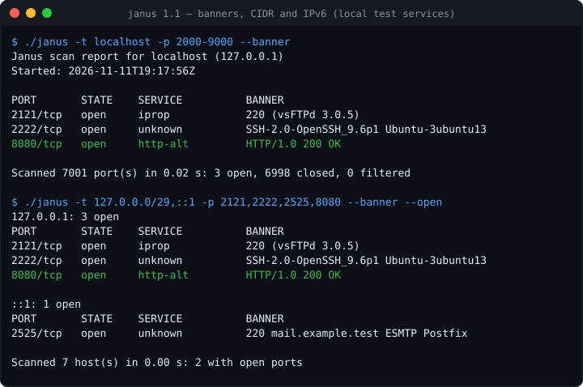
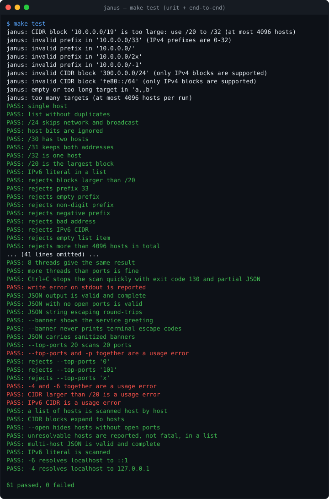
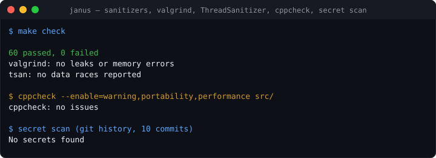
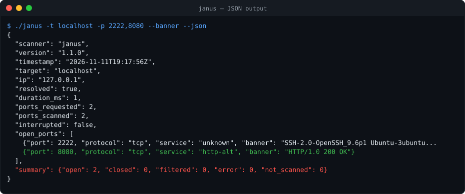

# Janus

[](https://github.com/fas0ftware/janus/actions/workflows/ci.yml)


A small, dependency-free **TCP connect and UDP port scanner** with **service and
version detection** for Linux, written in C11 with plain POSIX sockets and
pthreads.



Named after Janus, the Roman god of gates and doorways. Ports are doors.

> ## ⚠️ Authorized use only
>
> Janus is a defensive learning tool. Scan **only** your own devices, your own
> network, or systems you have explicit written permission to test. Scanning
> systems without permission may be illegal where you live and is against the
> terms of most networks. Janus deliberately has no stealth, evasion or exploit
> features.

## Features

- Full TCP connect scan: **open**, **closed** and **filtered** (timeout) detection
- **UDP scan** (`--udp`, no root): a reply means **open**, an ICMP "port
  unreachable" means **closed**, silence means **open|filtered**. DNS, NTP,
  NetBIOS, SSDP and mDNS get their standard query so they answer; the default
  is the 20 most common UDP ports
- Non-blocking `connect()` + `poll()` with a per-port timeout
- **Measured latency** per host (median time of its answers), and
  **`--adaptive`**: wait only as long as the host's measured round-trip time
  needs (the TCP retransmission formula `srtt + 4·rttvar`, at least 100 ms),
  trying silent ports twice. Filtered ports stop costing the full `--timeout`
- **IPv4 and IPv6** (`-4` / `-6` to force a family when resolving names)
- **Several targets per run:** lists (`host1,host2`) and IPv4 **CIDR blocks**
  (`192.168.1.0/24`, from /20 to /32), with `--open` to list only hosts that
  have open ports
- **Host discovery** (`--discover`): probes all hosts in parallel first and
  port-scans only those that answer, so a mostly empty `/24` no longer costs
  one full timeout per port for every silent host. Works without root
- Port lists and ranges: `80`, `22,80,443`, `1-1024`, `22,80-90,8000`, or
  `--top-ports N` for the N most commonly open ports (up to 100)
- **Banner grabbing** (`--banner`): the first line a service sends (SSH, FTP,
  SMTP...), or the HTTP status line on web ports. Output is reduced to
  printable ASCII, so a hostile service cannot inject terminal escape codes
- Parallel scanning with one pthread worker pool shared by **all hosts and ports**
  (`--threads`, max 256), so a `/24` with 20 ports per host keeps every thread busy
- **Service and version detection** (`--sv`): asks each open port what it
  really runs instead of trusting the port number: `OpenSSH 9.6p1`,
  `nginx 1.24.0`, `TLS 1.3, TLS_AES_256_GCM_SHA384`, `MariaDB 10.11.6`, Redis,
  vsftpd, Postfix, Dovecot, VNC, telnet... A silent port gets a hand-written
  TLS ClientHello and an HTTP `HEAD`; nothing else is ever sent. With `--udp`,
  DNS, NTP, NetBIOS (computer name), SSDP and mDNS replies are decoded
- **TLS certificate check** (with `--sv`): who the certificate is for, who
  signed it (or that it is self-signed), until when it is valid (**EXPIRED**
  is flagged), its key (`RSA 2048`, `EC P-256`) and its subjectAltName list.
  Host names are sent as SNI, so virtual hosts show the right certificate
- **STARTTLS check** (with `--sv`): SMTP, IMAP, POP3, FTP and PostgreSQL are
  asked to switch to TLS (`STARTTLS`, `STLS`, `AUTH TLS`, `SSLRequest`), so a
  mail server's TLS version and certificate show up too, and a server that
  does **not** offer TLS is flagged: its passwords travel in clear text
- Service names from `/etc/services` (`22` → `ssh`) when `--sv` is not used
- Human-readable table or **JSON** output for other programs
- Clean `Ctrl+C`: stops within ~0.1 s and prints partial results
- Strict input validation, zero compiler warnings, clean under valgrind,
  AddressSanitizer, UBSan and ThreadSanitizer

## Build

Requirements: Linux, `gcc`, `make`. Tests also need `python3`; `make check`
needs `valgrind`.

```sh
make            # release build  -> ./janus
make debug      # ASan + UBSan   -> ./janus-debug
make test       # run the test suite against local listeners
make check      # tests under sanitizers, valgrind leak check, ThreadSanitizer
make clean      # remove build output
```

## Usage

```
Usage: janus -t <target> [options]

  -t, --target <spec>   host name, IPv4/IPv6 address, list (a,b,c) or IPv4
                        CIDR block /20-/32, e.g. 192.168.1.0/24 (required)
  -p, --ports <list>    ports: 80 | 22,80,443 | 1-1024 | 22,80-90 (default 1-1024)
      --top-ports <n>   the n most common ports, 1-100 (instead of -p)
  -u, --udp             scan UDP instead of TCP (no root needed). Default ports:
                        the 20 most common UDP ports; --top-ports takes 1-20
                        Silent ports are reported as open|filtered
      --timeout <ms>    wait per port in milliseconds, 1-60000 (default 1000)
      --threads <n>     parallel workers across all hosts, 1-256 (default 16)
      --adaptive        measure each host's round-trip time and wait only as
                        long as it needs (at least 100 ms, at most --timeout);
                        silent ports are tried twice. TCP only
      --banner          read a short greeting from open ports (HTTP ports
                        get a HEAD request); nothing else is sent
      --sv              identify what really runs on open ports: service,
                        product and version (OpenSSH 9.6p1, nginx 1.24.0,
                        TLS 1.3, MySQL, ...). Silent ports get a TLS and an
                        HTTP probe. TLS ports show their certificate (name,
                        issuer, expiry, key); SMTP, IMAP, POP3, FTP and
                        PostgreSQL are asked for STARTTLS. With --udp,
                        replies are decoded
      --open            with several hosts, list only hosts with open ports
      --discover        first find which hosts answer (TCP probes, no root
                        needed) and port-scan only those; down hosts are skipped
      --discover-ports <list>
                        ports to probe for --discover (default 22,80,443,445,8080);
                        implies --discover
  -4 / -6               use only IPv4 / only IPv6 when resolving names
      --json            print the result as JSON (open ports only)
  -h, --help            show this help and exit
  -v, --version         show the version and exit
```

### Examples

Scan the first 10000 ports of your own machine:

```console
$ ./janus -t localhost -p 1-10000 --threads 32
Janus scan report for localhost (127.0.0.1)
Started: 2026-11-11T17:55:00Z

PORT       STATE    SERVICE
22/tcp     open     ssh
631/tcp    open     ipp
8000/tcp   open     unknown

Scanned 10000 port(s) in 0.03 s: 3 open, 9997 closed, 0 filtered
```

Check a few ports on a device in your home network with a short timeout:

```console
$ ./janus -t 192.168.1.1 -p 22,53,80,443 --timeout 300
```

Your own subnet, the 100 most common ports, short timeout, only hosts with
something open:

```console
$ ./janus -t 192.168.1.0/24 --top-ports 100 --timeout 300 --open
```

All (host, port) pairs share one pool of `--threads` workers, started host by
host. Without `--discover`, a host that is down makes every port wait for the
full timeout, so keep `--timeout` short and the port list small for whole
subnets, or let Janus skip the silent hosts first:

```console
$ ./janus -t 192.168.1.0/24 --top-ports 100 --timeout 300 --discover
192.168.1.1: 2 open
PORT       STATE    SERVICE
53/tcp     open     domain
80/tcp     open     http

192.168.1.23: no open ports

Scanned 254 host(s) in 6.41 s: 2 up, 252 down, 1 with open ports
```

(Illustrative output.) Hosts that are down are counted in the summary, not
listed. With a single host, a silent target prints `Host seems down` and exits
with 0; run without `--discover` to scan it anyway. If your devices ignore the
default probe ports, probe others: `--discover-ports 22,80,443,3389,5353`.

A host behind a firewall that drops packets: every silent port costs the
full `--timeout`. With `--adaptive`, Janus learns from the ports that do
answer how far away the host is, and waits only that long (twice):

```console
$ ./janus -t 192.168.1.1 -p 1-1024 --timeout 2000 --adaptive
...
Scanned 1024 port(s) in 14.6 s: 3 open, 12 closed, 1009 filtered
Latency: 0.84 ms (median of the host's answers)
```

(Illustrative output; without `--adaptive` the same scan waits 2 s for each
of the 1009 silent ports, about 2 minutes with 16 threads.) Every report
shows the host's latency when it answered at all; JSON has `latency_ms`
per host (`null` if it never answered).

What really runs on your own machine, not what the port number suggests
(`--service-version` is the long form):

```console
$ ./janus -t localhost -p 22,443,631,3306,6379,8000 --sv
Janus scan report for localhost (127.0.0.1)
Started: 2026-11-14T08:10:00Z

PORT       STATE    SERVICE          VERSION
22/tcp     open     ssh              OpenSSH 9.6p1 (Ubuntu-3ubuntu13.5)
443/tcp    open     tls/https        TLS 1.3, TLS_AES_256_GCM_SHA384
           cert: nas.home.arpa, self-signed, valid until 2025-03-01, RSA 2048, EXPIRED
           names: nas.home.arpa, 192.168.1.10
631/tcp    open     http             CUPS 2.4 (IPP/2.1)
3306/tcp   open     mysql            MariaDB 10.11.6 (0+deb12u1)
6379/tcp   open     redis            Redis
8000/tcp   open     http             SimpleHTTP 0.6 (Python/3.12.3)

Scanned 6 port(s) in 0.02 s: 6 open, 0 closed, 0 filtered
```

(Illustrative output.) A port that answers none of the probes keeps `-` in
the VERSION column. Under a TLS port Janus prints the server certificate:
here a forgotten NAS whose self-signed certificate ran out. Scan by host name
(`-t nas.home.arpa`) when one server hosts several sites: the name is sent as
SNI, so the server presents the certificate for that site. Add `--banner` to see each port's raw first line under
it. In JSON every open port gets a `detected` object (or `null`):

```json
{"port": 22, "protocol": "tcp", "service": "ssh",
 "detected": {"service": "ssh", "product": "OpenSSH", "version": "9.6p1", "info": "Ubuntu-3ubuntu13.5"}}
```

`service` stays the `/etc/services` name, so programs that read it keep
working; `detected.service` is what the port actually spoke. TLS ports also
get `detected.certificate`:

```json
"certificate": {"subject": "nas.home.arpa", "issuer": "nas.home.arpa", "self_signed": true,
                "not_before": "2024-03-01T10:00:00Z", "not_after": "2025-03-01T10:00:00Z",
                "expired": true, "not_yet_valid": false, "key": "RSA 2048",
                "names": ["nas.home.arpa", "192.168.1.10"]}
```

`expired` is judged against the scan's own `timestamp`. The certificate is
`null` when the server only speaks TLS 1.3, which encrypts it.

Mail, FTP and PostgreSQL servers start in plain text and switch to TLS on
request. Janus asks, and reports the answer:

```text
25/tcp     open     smtp             Postfix
           starttls: TLS 1.3, TLS_AES_256_GCM_SHA384
           cert: mail.home.arpa, issuer R11, valid until 2027-01-31, EC P-256
143/tcp    open     imap             Dovecot
           starttls: NOT OFFERED (logins travel in clear text)
```

(Illustrative output.) In JSON, `detected.starttls` is
`{"offered": true, "tls": "TLS 1.3, ..."}`, `{"offered": false}`, or `null`
for protocols without an upgrade command.

UDP scan of your own machine or router (silent ports show as `open|filtered`):

```console
$ ./janus -t 192.168.1.1 --udp --timeout 500
```

```text
PORT       STATE          SERVICE
53/udp     open           domain
1900/udp   open|filtered  unknown
```

(Illustrative output.) UDP is connectionless, so Janus can only be certain
about a port when something answers (open) or the kernel reports an ICMP
error (closed). A service that ignores Janus' probe looks the same as a
firewall that drops it: both are `open|filtered`.

JSON output, e.g. for another program to consume (with several targets the
document has a `hosts` array instead, plus `summary.hosts_with_open_ports`; with
`--discover` every host also gets `"status": "up"` or `"down"`, and the summary
gains `hosts_up` and `hosts_down`). Every document says `"protocol": "tcp"` or
`"udp"`; UDP scans add an `open_filtered_ports` array and `summary.open_filtered`:

```console
$ ./janus -t localhost -p 22,80,443,631,8000 --json
{
  "scanner": "janus",
  "version": "1.9.0",
  "timestamp": "2026-11-11T17:55:00Z",
  "target": "localhost",
  "ip": "127.0.0.1",
  "protocol": "tcp",
  "resolved": true,
  "duration_ms": 0,
  "ports_requested": 5,
  "ports_scanned": 5,
  "interrupted": false,
  "open_ports": [
    {"port": 22, "protocol": "tcp", "service": "ssh"},
    {"port": 631, "protocol": "tcp", "service": "ipp"},
    {"port": 8000, "protocol": "tcp", "service": "unknown"}
  ],
  "summary": {"open": 3, "closed": 2, "filtered": 0, "error": 0, "not_scanned": 0}
}
```

Reading it from Python:

```python
import json, subprocess

completed = subprocess.run(
    ["./janus", "-t", "localhost", "-p", "1-1024", "--json"],
    capture_output=True, text=True,
)
report = json.loads(completed.stdout)
print([p["port"] for p in report["open_ports"]])
```

### Output and exit codes

Results go to **stdout**; warnings and errors go to **stderr**, so JSON on
stdout is never mixed with messages.

| Exit code | Meaning                                                      |
|-----------|--------------------------------------------------------------|
| 0         | scan finished                                                |
| 1         | runtime error (host cannot be resolved, output write failed) |
| 2         | invalid command-line input                                   |
| 130       | interrupted with Ctrl+C (partial results were printed)       |

## How it works

For every port Janus opens a TCP socket in non-blocking mode and calls
`connect()`. The kernel sends a **SYN**:

- **SYN-ACK** comes back → handshake completes → **open**
- **RST** comes back → "connection refused" → **closed**
- nothing comes back before `--timeout` → **filtered** (usually a firewall
  dropping packets)

`poll()` waits for the answer, and `getsockopt(SO_ERROR)` tells which of the
cases happened. The socket is closed right after, which sends FIN (or RST) to
the target. See [docs/how-it-works.md](docs/how-it-works.md) for the details,
including what happens on the wire.

With `--sv`, an open port gets up to three more short conversations: Janus
first listens for a greeting (or sends the port's usual opening), then tries a
TLS ClientHello and an HTTP `HEAD` on fresh connections, and stops at the
first reply it recognizes. The parsers live in `src/fingerprint.c` and treat
every reply as hostile input (section 9 of how-it-works explains the probes,
the TLS parsing and why TLS is tried before HTTP).

## Project structure

```
src/
  main.c        entry point: parse options, resolve, scan, print, clean up
  cli.c/.h      getopt_long parsing, port list parser, input validation, help
  scanner.c/.h  resolve_target (IPv4/IPv6), connect_with_timeout, banners, global work queue
  targets.c/.h  target lists, CIDR expansion, top-ports table
  discovery.c/.h  --discover: parallel TCP probes that decide which hosts are up
  udp_scan.c/.h   --udp: datagram probes, ICMP errors via ECONNREFUSED, DNS/NTP payloads
  version_scan.c/.h  --sv over TCP: which probe to send when, reading replies
  fingerprint.c/.h   --sv parsers (SSH, HTTP, TLS, MySQL, ...), X.509 certificates, the TLS ClientHello
  services.c/.h port number -> service name (getservbyport)
  output.c/.h   text table and hand-written JSON with string escaping
  utils.c/.h    error printing, monotonic clock, UTC timestamps
tests/
  run_tests.sh          end-to-end tests against local listeners
  filtered_listener.py  simulates a filtered port without root
  banner_listener.py    greets clients with a banner (also hostile escape codes)
  udp_listener.py       UDP listener that answers or stays silent
  service_listener.py   --sv: real TLS server, Redis-style replies, a silent service
  test_udp.c            unit tests: UDP probe payloads
  test_json_escape.c    unit test for JSON string escaping
  test_targets.c        unit tests: lists, CIDR edge cases, banner sanitizing
  test_fingerprint.c    unit tests: every --sv parser, truncated and hostile replies
docs/
  how-it-works.md       TCP connect scanning explained
```

## Tests and checks

`make test` runs 141 C unit checks (target lists, CIDR edge cases such as /31,
/32 and oversized blocks, banner sanitizing, UDP probe payloads, the
adaptive timeout formula, and 97 for
`--sv`: every fingerprint parser with real, truncated and hostile replies,
the TLS ClientHello layout and SNI, a real X.509 certificate cut at every
length and corrupted 2345 ways, STARTTLS reply framing) and 130 end-to-end checks against
local listeners: open/closed/filtered, threads (also across hosts), Ctrl+C, write errors, JSON,
banners (including a listener that sends terminal escape codes), top ports,
lists, CIDR, `--open`, unresolvable hosts in a list, IPv6 and `-4`/`-6`,
host discovery (up, down, JSON status, Ctrl+C while probing), UDP (open,
closed, open|filtered, JSON, Ctrl+C) and `--sv` (SSH, HTTP on an odd port, a
real TLS server with a certificate per SNI name, a TLS 1.3-only server,
SMTP/IMAP/POP3/FTP servers that switch to TLS and one that cannot, Redis,
MariaDB, a silent service, JSON, Ctrl+C), latency reporting and `--adaptive`
(same results, a filtered port in 0.2 s instead of 3 s).



(The machine in this picture had no IPv6, so its 4 IPv6 checks were skipped:
126 of the 130. CI runs all of them.)

`make check` repeats the suite under AddressSanitizer + UBSan, runs valgrind
with leak checking (including a CIDR + IPv6 + banner scan) and
ThreadSanitizer. CI builds with gcc **and** clang using `-Werror`, runs all of
it, plus cppcheck.



<details><summary>JSON output with banners</summary>



</details>

## Limitations

- IPv6 targets must be single addresses or names (IPv6 CIDR blocks are not
  expanded)
- No SYN scans or other stealth techniques: a TCP scan completes the handshake,
  so every open port sees a full connection and the target's logs will show it
  (this is intentional, Janus is not stealthy)
- `--discover` is a TCP probe, not an ARP or ICMP ping: a host that drops every
  packet on all probe ports looks down and is skipped. Probe more ports with
  `--discover-ports` when that matters
- UDP: most services ignore an empty datagram, so many open UDP ports show up
  as `open|filtered`. Only DNS (53), NTP (123), NetBIOS (137), SSDP (1900) and
  mDNS (5353) get a protocol-specific probe; SNMP is deliberately not probed,
  because it would need a guessed community string. Linux
  also rate-limits ICMP errors (about one per second per remote host), so a
  fast UDP scan of a *remote* host can report closed ports as `open|filtered`
  (localhost is exempt). Use a longer `--timeout` and fewer `--threads` there
- "filtered" means "no answer in time": a slow or overloaded host can look
  filtered if the timeout is too short. `--adaptive` makes this trade-off on
  purpose: its timeout follows the host's measured RTT, and a host whose
  answers suddenly slow down by much more than its usual jitter can have
  ports reported filtered. The first ports (before 3 answers were measured,
  one per thread) still use the full `--timeout`. UDP is not adaptive:
  there, silence is itself the result (`open|filtered`)
- Without `--sv`, service names come from `/etc/services` (the port's usual
  service, not necessarily what runs there)
- `--sv` knows a fixed set of protocols (SSH, HTTP/RTSP, TLS, FTP, SMTP, POP3,
  IMAP, MySQL/MariaDB, PostgreSQL, Redis, memcached, AMQP, VNC, telnet). It
  has no TLS library, so it reports the TLS version, cipher and certificate of
  `443` but not the web server behind it. A server that speaks only TLS 1.3
  keeps its certificate encrypted (`certificate: null`). The certificate is
  read, not verified: Janus does not check the signature chain against trusted
  CAs, it only reports what the server presents. Products that do not name
  themselves (Postfix hides its version) stay without a version
- Linux only

## Roadmap

- Integration as the scanning engine of `network-monitor` (via `--json`)

## Changelog

- **1.9.0** – measured latency and `--adaptive`. Every answer (SYN-ACK, RST,
  UDP reply, ICMP error) is timed; reports show the host's median latency
  (`latency_ms` in JSON). `--adaptive` keeps a smoothed RTT per host
  (RFC 6298) and gives each TCP connect `srtt + 4·rttvar` (100 ms to
  `--timeout`), retrying silent ports once, so filtered ports no longer cost
  the full timeout. 6 unit and 8 end-to-end checks; TSan and valgrind runs.

- **1.8.0** – STARTTLS in `--sv`: SMTP (`EHLO`, `STARTTLS`), IMAP
  (`STARTTLS`), POP3 (`STLS`), FTP (`AUTH TLS`) and PostgreSQL (`SSLRequest`)
  are upgraded on a fresh connection; the TLS version, cipher and certificate
  appear under the port, or `NOT OFFERED` when the server keeps logins in clear
  text. Multi-line `220-` greetings are read to the end (vsftpd behind a
  welcome text is now recognized). JSON: `detected.starttls`, and
  `detected.certificate` is now present for every identified port (`null`
  when there is none). 11 unit and 6 end-to-end checks.

- **1.7.0** – TLS certificates in `--sv`: subject, issuer or self-signed,
  validity with **EXPIRED** / **NOT YET VALID**, key type and size, and
  subjectAltName names, from a small bounds-checked DER parser. Host names are
  sent as SNI. TLS 1.3 servers get a second, TLS 1.2-only ClientHello because
  1.3 encrypts the certificate. The handshake is reassembled across records.
  21 new unit checks (a real certificate truncated at every length and
  corrupted 2345 ways) and 4 end-to-end checks with an SNI-aware TLS server.

- **1.6.0** – `--sv` / `--service-version`: service and version detection.
  Open TCP ports are identified from their greeting or from up to three fixed
  probes (TLS ClientHello, `HEAD`, PostgreSQL SSLRequest): SSH, HTTP/RTSP
  (Server header), TLS (version and cipher from the ServerHello), FTP, SMTP,
  POP3, IMAP, MySQL/MariaDB, PostgreSQL, Redis, memcached, AMQP, VNC and
  telnet. UDP replies to the DNS, NTP, NetBIOS, SSDP and mDNS probes are
  decoded (NetBIOS computer name, mDNS service types, NTP stratum). New
  VERSION column, `detected` object in JSON, 65 parser unit tests and 16
  end-to-end tests including a real TLS server.

- **1.5.0** – more UDP probes: NetBIOS name service (137), SSDP (1900) and mDNS
  (5353) get their standard discovery query, so these services answer and show
  up as `open` instead of `open|filtered`.
- **1.4.0** – one worker pool for all hosts: `(host, port)` pairs go into a
  single queue, so small port lists on many hosts no longer leave threads
  idle. `duration_ms` is now measured per host. Fixed the README limitation
  that still said "TCP only".
- **1.3.0** – `--udp` / `-u`: unprivileged UDP scan (open, closed, open|filtered),
  DNS and NTP probes, 20 common UDP ports by default, `protocol` and
  `open_filtered_ports` in the JSON output, UDP listeners in the tests.
- **1.2.0** – `--discover` / `--discover-ports`: parallel host discovery with
  plain TCP probes (no root), hosts that do not answer are skipped, `status`,
  `hosts_up` and `hosts_down` in the JSON output, new tests, valgrind and
  ThreadSanitizer runs for the discovery code.
- **1.1.0** – IPv6, `-4`/`-6`, target lists and IPv4 CIDR blocks, `--open`,
  `--top-ports`, `--banner` with sanitized output, multi-host JSON, more unit
  and end-to-end tests, GitHub Actions CI (gcc + clang, sanitizers, valgrind,
  TSan, cppcheck).
- **1.0.0** – IPv4 TCP connect scan with threads, JSON, clean Ctrl+C.

## License

[MIT](LICENSE)
